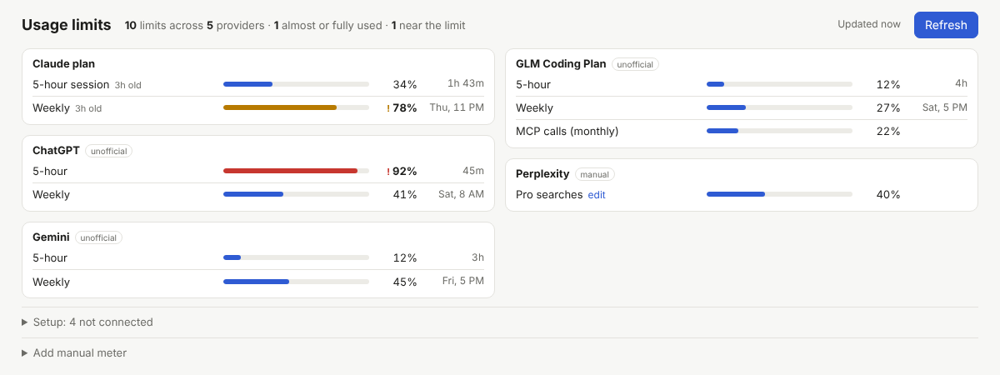

# usage-dashboard

One local page that shows how close you are to every usage limit across your AI subscriptions and APIs.



## Sources

| Service | How | Shows |
|---|---|---|
| Claude Pro/Max | Claude Code's own `/usage`, run in the background (experimental); falls back to its status line | 5-hour %, weekly %, per-model weekly % |
| ChatGPT Plus/Pro | Codex CLI's ChatGPT login, same call as Codex `/status` (unofficial) | 5-hour %, weekly % |
| Gemini AI Pro/Ultra | Runs the Antigravity CLI: `agy -p /usage` (unofficial output) | 5-hour %, weekly %, per model group |
| Anthropic API | Admin API: cost and usage reports | Month-to-date spend, tokens |
| OpenAI API | Admin API: organization costs | Month-to-date spend |
| GitHub Copilot | Billing usage API, AI credits | Credits used vs plan allotment |
| Cursor (team) | Admin API `/teams/spend` | Cycle spend, included-usage % |
| GLM Coding Plan | Z.ai quota endpoint (undocumented; used by Z.ai's own plugin) | 5-hour %, weekly %, monthly MCP tool calls |
| Perplexity, Cursor individual, any plan above without its CLI | Manual entry | Whatever you copy from their usage page |

Consumer chat plans have no official usage API, so the automatic routes go through each vendor's own CLI login. Without the CLI, use a manual meter. Nothing is scraped.

## Run

Requires Node 20 or later. No dependencies.

```sh
cp .env.example .env   # fill in the keys you have
npm start              # http://127.0.0.1:4317
npm test
```

The server binds to 127.0.0.1 only and rejects foreign Host headers. Keys never reach the browser.

## Claude Pro/Max setup

`npm run connect` sets up two sources. Both go through Claude Code itself, so the dashboard never reads or sends your Claude login.

| Source | Freshness | Notes |
|---|---|---|
| `claude -p "/usage"` (live) | Every dashboard refresh. Includes Claude desktop app and claude.ai use, since the limits are account-wide. | Claude Code must be installed and signed in to Pro/Max; it doesn't need to be open. Relies on Claude Code's `usage_report`, which Anthropic marks experimental. |
| Status-line hook (fallback) | Your last interactive Claude Code reply | Official field. Used when the live check fails; the card says why. |

Claude's OAuth usage endpoint is not used: Anthropic's terms say third parties may not "collect, store, or intermediate Claude.ai credentials or session tokens".

## Connect the CLI logins

Sign in to each CLI you use (`claude`, `codex` with "Sign in with ChatGPT", `agy`), then run:

```sh
npm run connect
```

It checks each login and turns on the matching provider in `.env`. For Claude Code it adds the status-line hook to `~/.claude/settings.json`, but only after asking, and it saves a backup first. It never prints, copies or refreshes a token. Restart the dashboard afterwards.

## ChatGPT and Gemini setup

Both are off by default because they use undocumented interfaces.

| | Needs | Turn on |
|---|---|---|
| ChatGPT | Codex CLI signed in with your ChatGPT account (not an API key; file storage, not keychain) | `CHATGPT_USAGE=on` |
| Gemini | Antigravity CLI (`agy`) installed and signed in | `GEMINI_AGY=on` |

ChatGPT is read-only. The dashboard reads `~/.codex/auth.json` (or `$CODEX_HOME/auth.json`), sends the token only to chatgpt.com, and never refreshes or rewrites it. Codex rotates refresh tokens, so a refresh from here would log the CLI out. When the token expires, the card asks you to run `codex` once.

Gemini runs `agy` itself and never touches its login. Google ended the Gemini CLI's Google-account login for consumer plans on 2026-06-18, and the Gemini CLI's terms forbid other tools reusing that login, so the Gemini CLI is not used.

## Meter status

| Status | Rule |
|---|---|
| warning | 75% or more used |
| critical | 90% or more used |
| stale | reset time has passed; the value is out of date |

API spend has no hard limit that the APIs report. Set a `*_MONTHLY_BUDGET_USD` value to turn spend into used / limit.

## Known uncertainty

These provider endpoints were checked against official docs on 2026-10-19. Some details were confirmed only from summaries of those docs:

| Provider | Uncertain detail |
|---|---|
| OpenAI | The type of `amount.value` in the cost results. |
| GitHub | The `ai_credit/usage` response fields. Credits are computed as gross USD / $0.01. |
| GitHub | Plan allotments: Pro 1,500, Pro+ 7,000, Max 20,000. GitHub says the flex part may change. |
| Cursor | Cursor's docs lag its live schema. |
| ChatGPT | Endpoint and fields read from openai/codex source; OpenAI publishes no policy on reading it from other tools. |
| Gemini | `agy` output format comes from one open-source client (CodexBar); not verified against `agy` itself. |
| GLM | No API reference exists. Window codes (`unit`/`number`) are inferred from Z.ai's plugin and two other clients; unknown windows are skipped. |

Each provider reads fields defensively. A provider that fails shows as one error card and does not affect the others.

## Add a provider

Create `providers/<name>.js` exporting `{ id, name, setup, configured(env), fetch(env, { signal, fetch }) }`. `fetch` returns meters: `{ id, label, used, limit, unit, period, resetsAt, note }`. Then register it in `providers/index.js`.

## License

MIT
